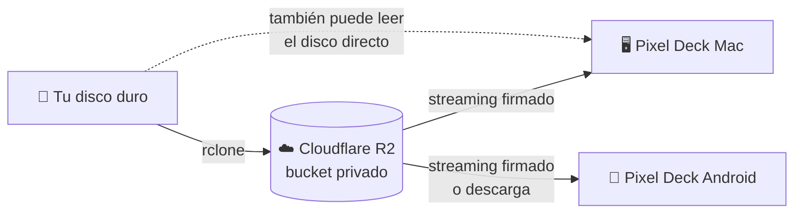

<div align="center">

# PIXEL**DECK**

### Tu propio "Spotify" con tu música de siempre

Sube tu colección a la nube y escúchala desde un reproductor retro estilo hi-fi en **Mac** y **Android**.


</div>

---

## ✨ Qué hace

| | |
|---|---|
| ☁️ **Tu música en la nube** | Toda tu colección en Cloudflare R2, privada. 45 GB cuestan unos **US$0,50 al mes** y escucharla no tiene costo extra. |
| 🖥️ **App para Mac** | Arrastras carpetas desde tu disco y se arma la lista, o reproduces directo desde la nube. Si desconectas el disco, sigue sonando desde la nube. |
| 📱 **App para Android** | Toda la biblioteca con buscador y filtro por carpetas, y descargas para escuchar **sin señal**. |
| 🎚️ **Sonido de verdad** | Ecualizador de 10 bandas con **PRE**, **MASTER** y limitador, presets, espectro y medidores VU reales. |
| 🎛️ **Transiciones y modo fiesta** | Las canciones se mezclan entre sí. En **modo fiesta**, la mezcla es estilo DJ (cambio de graves), el orden es aleatorio sin repetir y las luces siguen el ritmo. |
| 🔒 **Privado** | Sin servidores propios ni cuentas extra: las claves quedan solo en tus dispositivos, y en el celular se usa una de **solo lectura**. |

---

## 📸 Capturas

### Android

La versión móvil incorpora Inicio con recomendaciones de tu colección, exploración por géneros, artistas y portadas del bucket. Consulta [cómo organizar fotos y logos y usar el nuevo Inicio](docs/android-discovery.md).

<table>
  <tr>
    <td align="center"><br><b>Reproduciendo</b></td>
    <td align="center"><br><b>Filtro por carpetas</b></td>
    <td align="center"><br><b>Búsqueda</b></td>
  </tr>
  <tr>
    <td align="center"><br><b>Sonido y ecualizador</b></td>
    <td align="center"><br><b>Modo fiesta mezclando</b></td>
    <td align="center"><br><b>Descargas sin señal</b></td>
  </tr>
</table>

Al bajar por la lista, la parte de arriba se achica para dejar más espacio a las canciones:

<div align="center"></div>

### Mac

<div align="center"></div>

---

## 🧩 Cómo funciona



- Las apps hablan directo con R2 usando la API compatible con S3, con URLs firmadas que expiran.
- **No hay backend ni servidor propio** que mantener.
- En Android, el audio pasa por un motor de **dos bandejas** (como una mesa de DJ) para las mezclas, el ecualizador y los medidores.

---

## 🚀 Instalación

> Necesitas: una cuenta de Cloudflare, **Node 22+**, y para Android, **Java 21 y Android SDK** (incluidos en Android Studio).

<details>
<summary><b>1. Crear tu almacenamiento en Cloudflare R2</b></summary>

1. En Cloudflare, activa **R2 Object Storage**. Pide un método de pago, pero no cobra si usas poco: 10 GB gratis al mes.
2. Crea un bucket (por ejemplo, `mi-musica`) con clase **Standard** y acceso público **desactivado**.
3. Copia tu **S3 API endpoint** (en R2 → Account Details): `https://TU-ID.r2.cloudflarestorage.com`

**Claves** (R2 → *Manage API Tokens* → *Create API token*):
- Para subir música y para la app de Mac: **Object Read & Write**, solo para tu bucket.
- Para el celular: otra clave con **Object Read only**, solo para tu bucket.

Guarda el *Access Key ID* y el *Secret Access Key*, porque se muestran una sola vez. **Nunca los subas a GitHub ni los compartas.**

**CORS** (necesario para la app Android). En tu bucket → *Settings* → *CORS Policy* → *Add*:
```json
[
  {
    "AllowedOrigins": ["https://localhost"],
    "AllowedMethods": ["GET", "HEAD"],
    "AllowedHeaders": ["*"],
    "ExposeHeaders": ["Content-Length", "Content-Range", "Accept-Ranges"],
    "MaxAgeSeconds": 86400
  }
]
```
Esto deja que la app procese el audio (ecualizador, medidores, mezclas). El bucket sigue siendo privado.
</details>

<details>
<summary><b>2. Subir tu música con rclone</b></summary>

```bash
brew install rclone
rclone config create r2 s3 provider=Cloudflare \
  access_key_id=TU_ACCESS_KEY secret_access_key=TU_SECRET_KEY \
  endpoint=https://TU-ID.r2.cloudflarestorage.com acl=private no_check_bucket=true

rclone ls r2:mi-musica      # sin errores = conectado

caffeinate -i rclone copy "/ruta/a/tu/musica" r2:mi-musica \
  --progress --transfers 8 --exclude "._*" --exclude ".DS_Store"
```
- Si se corta, vuelve a correr el mismo comando: sigue desde donde quedó.
- Las carpetas de primer nivel (`ROCK/`, `REGGAETON/`, `ROMANTICA/`…) aparecen como filtros en las apps.
- 💡 Sube cerca del router o con cable de red: la velocidad cambia muchísimo.
</details>

<details>
<summary><b>3. App para Mac</b></summary>

```bash
cd escritorio
npm install
npm start          # para probar
npm run dist       # crea el instalador .dmg en escritorio/dist/
```
La app no está firmada por Apple, así que la primera vez ábrela con **clic derecho → Abrir**.
En **☁ NUBE → ⚙ NUBE** pones endpoint, bucket y claves, que se guardan cifradas en el llavero del Mac.
</details>

<details>
<summary><b>4. App Android (APK)</b></summary>

```bash
cd movil
npm ci
npm run android:apk
```
El comando compila la web, crea el proyecto Android si falta, agrega los permisos, sincroniza los plugins y genera el APK en `movil/android/app/build/outputs/apk/debug/app-debug.apk`. Puedes volver a ejecutarlo después de hacer cambios.

Necesitas **Java 21**, las plataformas **Android SDK 36**, **Build Tools 35.0.0** y las licencias del SDK aceptadas. Configura `ANDROID_HOME` con la ruta de tu SDK si no está detectado. La primera compilación descarga Gradle y las dependencias, así que necesita conexión a Internet.

Pasa el APK al celular (por cable, Drive, WhatsApp…), instálalo, acepta el permiso de notificaciones y escribe endpoint, bucket y tu clave de **solo lectura**.

**Compilar desde Android con Termux:** instala Node 22+, OpenJDK 21 y un Android SDK con los componentes anteriores. También necesitas un binario **AAPT2 para ARM compatible con SDK 36**; el AAPT2 del SDK Linux es para x86 y algunas versiones de Termux no pueden leer los recursos de SDK 36. Indica las rutas de tus herramientas:

```bash
export ANDROID_HOME=/ruta/al/android-sdk
export AAPT2_PATH=/ruta/al/aapt2-compatible
npm run android:apk
```

Se genera un APK **debug**, firmado para instalación directa. La compilación y la firma se verificaron en Termux; la reproducción y el funcionamiento en segundo plano deben probarse en el dispositivo.

Si aparece un error de **CORS** al reproducir, aplica la política del paso 1 al bucket donde está tu música. El origen de la app Android es `https://localhost`.

Si la música se corta con la pantalla apagada: *Ajustes → Apps → Pixel Deck → Batería → Sin restricciones*.
</details>

---

## 🔒 Seguridad

- **No hay claves en el código.** Cada persona escribe las suyas en la app.
- Usa siempre una clave de **solo lectura** en el celular.
- Si una clave se filtra, bórrala en Cloudflare (*Manage API Tokens*) y crea otra.

## 🛠️ Hecho con

Electron · Capacitor 8 · React · Vite · Web Audio API · AWS SDK (S3) · Cloudflare R2 · rclone

Desarrollado paso a paso junto a **Claude** (Anthropic).

## 📄 Licencia

MIT © SolidPixel. Úsalo, modifícalo y compártelo.
